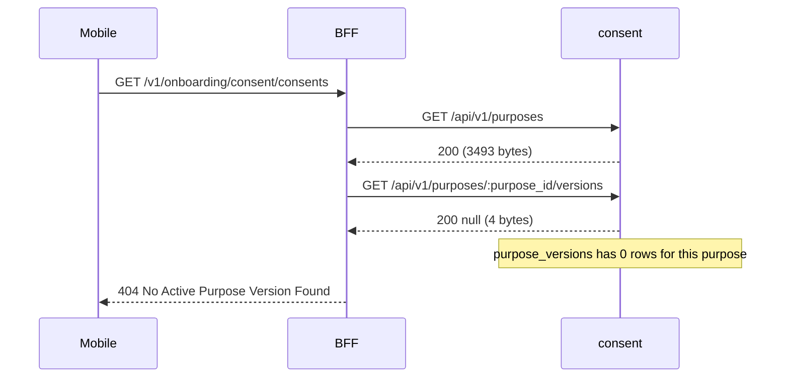
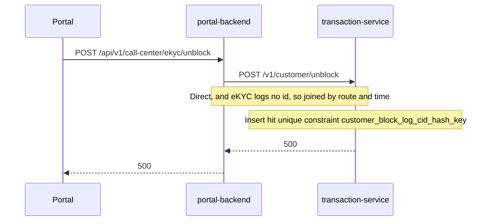

# Tracing: from a Mobile or Portal symptom to its root cause

One recipe for Core and Auxiliary, SIT and UAT. Use it when a report arrives as a symptom at the edge, such
as a mobile API error or a failing portal screen, rather than as a bug in a named service. It ends with a
diagram of every hop and a proven cause, because the hop that returned the error is often not the one at fault.

Measured on 2026-11-05 on both clusters of SIT and UAT. The shared cluster inspection procedure owns the
permission rule, and the [OpenSearch recipe](opensearch.md) owns login and index details.

## Rules

- **One environment, both domains.** Each environment's indices hold Core and Auxiliary, so a trace drops the
  `OS_CLUSTER` filter and needs no skill switch for OpenSearch. For Argo logs, a database or Kafka on the other
  domain, read that domain's skill for the same environment and use its `PROFILE_ENV` and bindings for that read:
  [Core SIT](../SKILL.md), [Auxiliary SIT](../../neo-aux-sit/SKILL.md), [Core UAT](../../neo-core-uat/SKILL.md),
  [Auxiliary UAT](../../neo-aux-uat/SKILL.md). Never answer from another environment.
- **Show hops, not values.** BFF lines carry `authorization`, `request_headers` and `response_body`; service
  lines carry `requestBody` and `responseBody`; `portal-backend` lines carry `body`; eKYC lines carry `cid`,
  `cidHash` and `cid_hash`; Kong's `request_uri` can hold a citizen id. The snippet below reads only safe fields
  and masks customer ids. Pass anything else you read from `log` through its `mask` before printing it, and keep
  other values out of reports unless the user asked for that message. Read a body value, or decode a token, only
  when the user asks for that message; a theory about a pattern across requests goes in the report as inferred,
  with the read that would test it.
- **Read `status`, never `msg` or `level`.** `External service call success` was logged with status 500, a
  failed `Mobile request completed` is `info`, and a successful service request is `debug`.

## How the id travels

Kong's `correlation-id-plugin` generates `X-Correlation-ID` as a uuid and echoes it to the client, so a reporter
can copy it from the response. `common-lib/httpclient` forwards it when the caller passes its context, and many
hops do not. Each source spells it differently, so search for the uuid itself:

| Source | Where | Field |
|---|---|---|
| Kong access log | `OS_ACCESS_INDEX` | `http_x_correlation_id` (a real field, can be empty) |
| `backend-for-frontend` | `OS_INDEX`, JSON in `log` | `correlation_id` |
| Services on `common-lib` | `OS_INDEX`, JSON in `log` | `correlationId` |
| `portal-backend` | `OS_INDEX`, `log` is `ts<TAB>LEVEL<TAB>caller<TAB>msg<TAB>{json}` | `correlationId` |
| Namespace `ekyc` | `OS_INDEX`, `log` is `ts\|LEVEL\|service\|[thread]\|FLOW\|\|\|logger\| msg` | None, except `face-verification-service` |
| Kafka message | Kafbat | header `x-correlation-id`, on some topics only |

In namespace `ekyc`, a stack trace line is its own document with no flow tag, and the time in the text is cut,
so use `@timestamp`.

| Leg | Route | Evidence |
|---|---|---|
| Mobile to BFF | Kong `app.<env>`, path `/bff/v1/...` | Kong row; BFF `Mobile request received` and `Mobile request completed`, path `/v1/...` |
| BFF to the same cluster | Direct, such as `account:8080` | No Kong row; BFF `External service call` and the service's `http request completed` |
| BFF to the other cluster | Kong `auxiliary.<env>/<service>/...` | Kong row, the BFF lines and the service line |
| Portal to `portal-backend` | Kong `auxiliary.<env>/portal-backend/...` | Kong row with an empty id, found by path and time; `url_authz_decision` holds the id |
| `portal-backend` to Core | Kong `core.<env>/<service>/...` | `portal-backend` lines, Kong row and service line |
| `portal-backend` to Auxiliary | Direct, such as eKYC | `portal-backend` lines; the target's lines by route and time |
| A script or test | Kong `core.<env>` directly, client such as `node` | Kong row and service lines; no BFF or `portal-backend` row |

## 1. Get an id

If the reporter gave one, use it. Otherwise search `OS_ACCESS_INDEX` for the mobile call, with `search` from the
snippet in step 2. Kong's path includes `/bff`, which BFF's own log drops:

```json
{
  "size": 5,
  "track_total_hits": true,
  "sort": [{ "@timestamp": { "order": "desc", "unmapped_type": "boolean" } }],
  "query": { "bool": { "filter": [
    { "term": { "status.keyword": "500" } },
    { "wildcard": { "request_uri.keyword": "/bff/v1/notification/register*" } },
    { "range": { "@timestamp": { "gte": "now-24h" } } }
  ] } },
  "_source": ["@timestamp", "http_x_correlation_id", "status", "http_host"]
}
```

For Portal, search `OS_INDEX`, because Kong's row for `/portal-backend/...` has an empty id, though it does show
the status and time. `url_authz_decision` carries the method, path and id:

```json
{
  "size": 5,
  "track_total_hits": true,
  "sort": [{ "@timestamp": { "order": "desc", "unmapped_type": "boolean" } }],
  "query": { "bool": { "filter": [
    { "term": { "kubernetes_container_name.keyword": "portal-backend" } },
    { "match_phrase": { "log": "url_authz_decision" } },
    { "match_phrase": { "log": "/api/v1/customer-360/v2/search" } },
    { "range": { "@timestamp": { "gte": "now-24h" } } }
  ] } },
  "_source": ["@timestamp", "log"]
}
```

With no path to search for, group recent failures with a `terms` aggregation on `request_uri.keyword`, filtered by
`{ "wildcard": { "status.keyword": "5*" } }`, and mask the keys before printing them.

Pick the hit closest to the reported time. Report how many matched and which one you chose. When a failure
repeats, trace more than one hit and compare their causes, because the newest may not be the common case.

## 2. Run the trace

In the logged-in `OS_HOST` tab, bind the values from the active skill and run this with Claude in Chrome's
`javascript_tool`. It uses a synchronous XHR, so it also suits a harness that cannot await.

```js
(() => {
  const OS_INDEX = "BIND", OS_ACCESS_INDEX = "BIND", OS_VERSION = "BIND", CID = "BIND", PAD_MS = 2000;
  function search(index, body) {
    const xhr = new XMLHttpRequest();
    xhr.open("POST", "/_dashboards/api/console/proxy?path=" + encodeURIComponent(index + "/_search") + "&method=POST", false);
    xhr.setRequestHeader("osd-xsrf", "true");
    xhr.setRequestHeader("osd-version", OS_VERSION);
    xhr.setRequestHeader("content-type", "application/json");
    xhr.setRequestHeader("accept", "application/json");
    xhr.send(JSON.stringify(body));
    return { status: xhr.status, json: xhr.status === 200 ? JSON.parse(xhr.responseText) : null };
  }
  const mask = (s) => typeof s === "string"
    ? s.replace(/\b(cid(?:_?hash)?)([)("=:\s]+)[^\s,"')]+/gi, "$1$2<id>").replace(/\)=\([^)]*\)/g, ")=(<value>)").replace(/\b\d{6,}\b/g, "<id>").replace(/\b[0-9a-f]{32,}\b/gi, "<hash>")
    : undefined;
  // Spaced slashes stop Claude in Chrome masking a path as [BLOCKED: Base64 encoded data].
  const clean = (s) => mask(typeof s === "string" ? s.replace(/^https?:\/\//, "").split("?")[0].replace(/\//g, " / ") : s);
  function parseLog(raw) {
    const line = String(raw);
    try { return JSON.parse(line); } catch {}
    const tab = line.split("\t");
    if (tab.length > 3) {
      let tail = {};
      try { tail = JSON.parse(tab.slice(4).join("\t")); } catch {}
      return { ...tail, level: tab[1], msg: tab[3] };
    }
    const pipe = line.split("|");
    return pipe.length > 8 ? { level: pipe[1].trim(), flow: pipe[4].trim(), msg: pipe.slice(8).join("|").trim() } : { msg: line };
  }
  function appRow(h) {
    const s = h._source, j = parseLog(s.log), http = j.http || {};
    const body = typeof j.response_body === "string" ? j.response_body : null;
    return { t: s["@timestamp"], src: "app", where: s.cluster_name + "/" + s.kubernetes_container_name,
      level: String(j.level || "").toLowerCase(), flow: j.flow, msg: mask(j.msg)?.slice(0, 200), step: j.journey_step,
      method: j.method || http.method, path: clean(j.path || http.path || j.url), route: clean(http.route),
      status: j.status ?? j.status_code ?? j.statusCode ?? http.statusCode ?? j.outcome?.http_status,
      bytes: http.responseSizeBytes ?? (body === null ? undefined : body.length),
      empty: ["null", "[]", "{}", ""].includes(body) || undefined,
      error: clean(typeof j.error === "string" ? j.error : j.error?.message)?.slice(0, 200) };
  }
  function kongRow(h) {
    const s = h._source;
    return { t: s["@timestamp"], src: "kong", where: s.cluster_name + "/" + clean(s.http_host),
      method: s.request_method, path: clean(s.request_uri), status: s.status, upstream: s.upstream_status,
      bytes: s.body_bytes_sent, seconds: s.duration_seconds, client: (s.http_user_agent || "").split("/")[0] };
  }
  const sort = [{ "@timestamp": { order: "asc", unmapped_type: "boolean" } }, { _id: { order: "asc" } }];
  const appFields = ["@timestamp", "log", "cluster_name", "kubernetes_container_name"];
  const kongFields = ["@timestamp", "cluster_name", "http_host", "request_method", "request_uri", "status", "upstream_status", "body_bytes_sent", "duration_seconds", "http_user_agent"];
  const whole = (r) => r.json?.hits.hits.length === r.json?.hits.total.value;
  const byTime = (a, b) => String(a.t).localeCompare(String(b.t));

  const idMatch = { match_phrase: { log: CID } }, idTerm = { term: { "http_x_correlation_id.keyword": CID } };
  const app = search(OS_INDEX, { size: 500, track_total_hits: true, sort, query: { bool: { filter: [idMatch] } }, _source: appFields });
  const gw = search(OS_ACCESS_INDEX, { size: 200, track_total_hits: true, sort, query: { bool: { filter: [idTerm] } }, _source: kongFields });
  const rows = [...(app.json?.hits.hits || []).map(appRow), ...(gw.json?.hits.hits || []).map(kongRow)].sort(byTime);
  const out = { statuses: [app.status, gw.status], appTotal: app.json?.hits.total.value, gwTotal: gw.json?.hits.total.value, complete: whole(app) && whole(gw), rows };
  if (!rows.length) return out;

  // Failures in the same window whose lines lack this id: the hops that dropped it.
  const shift = (t, ms) => new Date(Date.parse(t) + ms).toISOString();
  const windowed = { range: { "@timestamp": { gte: shift(rows[0].t, -PAD_MS), lte: shift(rows.at(-1).t, PAD_MS) } } };
  const nearApp = search(OS_INDEX, { size: 2000, track_total_hits: true, sort, query: { bool: { filter: [windowed], must_not: [idMatch, { term: { "kubernetes_container_name.keyword": "ingress-controller" } }] } }, _source: appFields });
  const nearGw = search(OS_ACCESS_INDEX, { size: 2000, track_total_hits: true, sort, query: { bool: { filter: [windowed], must_not: [idTerm] } }, _source: kongFields });
  const failed = (r) => r.error || ["error", "warn", "warning", "fatal"].includes(r.level) || Number(r.status) >= 400;
  out.window = windowed.range["@timestamp"];
  out.nearComplete = whole(nearApp) && whole(nearGw);
  out.near = [...(nearApp.json?.hits.hits || []).map(appRow), ...(nearGw.json?.hits.hits || []).map(kongRow)].filter(failed).sort(byTime);
  return out;
})()
```

Stop and fix the request if a status is not 200, or if `complete` or `nearComplete` is false. `complete` means
every line holding the id came back, not that every hop did.

- `rows` is every line and Kong row holding the id. Read it by hop, not strictly by time, because a Kong row can
  log just after the response it carries.
- `near` is every warning, error and 4xx or 5xx in the same window that lacks the id. These come from any request,
  so keep one only when its service, path and time fit a hop in `rows`, and mark that join as inferred.
- `bytes` on a BFF row counts the characters of the body it logged, so take sizes from Kong or the service.

Raise `PAD_MS` for a slow consumer. UAT writes about 60 lines per second, so 2000 lines is about 30 seconds.
To read one container over the window, add a `term` on `kubernetes_container_name.keyword` to `windowed`'s
filter and map the hits through `appRow`.

## 3. Find the first wrong hop

Start at the edge and walk inward until the inner hops are healthy. The cause is at or below the deepest hop
whose answer is wrong, so do not stop at the one that returned the error to the user.

| What the rows show | Reading | Next |
|---|---|---|
| The edge is 2xx, but an inner row or a `near` row failed | The caller swallowed it, so the user sees something missing rather than an error | Report the edge result and each failure separately, and follow each one |
| A service answers 200 with `empty: true` or a few bytes, and its caller returns 404 | The service found nothing | Count the rows in its database (step 5) |
| An app row has status 500 or above, or an `error` | That service failed | Read its `error`; a wrapped error names the next dependency |
| A hop has no row for the id, and `near` holds a failure that fits it | That hop dropped the id | Read that container over the window, and count requests on both sides to confirm the pairing |
| A Kong row failed, with no line from that service in `rows` or `near` | Its namespace is not indexed, or it logged nothing | Read its logs through kubectl, or Argo where kubectl is blocked, and ask the user to log in if Argo needs it |
| A caller returns 4xx while every inner hop is 2xx with data | The caller decided | Read the caller's `error` line |
| `external_request` has no `external_response` (not seen live) | The call never returned | Check that target's Kong row and pod health |
| No rows at all (not seen live) | Wrong id or wrong environment, or the request never reached Kong | Search by path (step 1), and ask which environment |

A missing row does not mean a missing hop:

- Only some namespaces are indexed: see the OpenSearch recipe's surface table and the UAT access notes' coverage.
  Auxiliary `notification` is not, so `push-notification-service` shows only as a Kong row.
- These logged no id in 7 days on UAT: `authentication`, `customer-api`, `as400adapter`, `wai-adapter`,
  `transaction-consumer`, `email-service`, `email-gateway`, `e-document-worker`, `special-list-service`,
  `common-api`, `qr-service`, `transaction-api`, `portal-uam`, `portal-cube`, `portal-cms`, `portal-ticket-service`,
  and `transaction-service` in namespace `ekyc`. `account` holds it on a third of its lines and `portal-backend`
  on a fifth.
- A Kong row can have an empty id: every `/portal-backend/*` and `/portal-cube/*` row on UAT, and `account`'s call
  to `push-notification-service`.
- A direct call inside a cluster has no Kong row.

Namespace decides whose service it is: `transaction-service` in `ekyc` is eKYC's, not Core's `transaction`.

The snippet does not reach pod logs. When you read them through kubectl or Argo, count lines by `msg`, and print only
`msg`, `level`, `caller` and an `error` passed through `mask`, because such lines also hold `customer_id`,
`idempotency_key` and tokens. Argo's `timeStamp` is in whole seconds, so join to Kong within one second, and match
every failure on both sides before calling the error the cause of all of them.

## 4. Cross a Kafka hop

Find the message with the [Kafka recipe](kafka.md), then pick the carrier its topic has. A past event already has
its offsets, so go straight to finding it from the request's time. Core's Kafka holds `account-service-*`,
`neocis-*`, `neopay-*` and `txn-*`; Auxiliary's holds `ekyc-*`, `email-gateway-*`, `fraud-*` and `push-notification-*`.

| Carrier | Measured on | Follow with |
|---|---|---|
| Header `x-correlation-id` | `neopay-transfer-v1-*`, `account-service-open-success-event`, `txn-statement-request-completed.dlq` | The header value |
| Value `correlation_id`, no header | `txn-statement-request-completed` | Match the field in `value`, not the headers |
| Header on some messages only | `fraud-audit-events`, `push-notification-template-send-v1` | A miss on the header is not proof; try a business id |
| Own ids only | `ekyc-completed-*` (`trans_ref`, `ekyc_trans_id`), `email-gateway-send-v1` (`email_id`) | That id, from the producer's log or payload |

A consumer that logs no correlation id can still log the message position, so join on topic and offset. Message
offset 141 on `neopay-transfer-v1-success` matched this `transaction-consumer` line:

```json
{
  "size": 10,
  "track_total_hits": true,
  "sort": [{ "@timestamp": { "order": "asc", "unmapped_type": "boolean" } }],
  "query": { "bool": { "filter": [
    { "term": { "kubernetes_container_name.keyword": "transaction-consumer" } },
    { "match_phrase": { "log": "neopay-transfer-v1-success" } },
    { "match_phrase": { "log": "\"offset\":141" } }
  ] } },
  "_source": ["@timestamp", "log"]
}
```

Add `partition` when the topic has more than one. `transaction-consumer` also logs `transaction_id` and
`account_id`, so keep only the safe fields you need. Check lag and members under the Kafka recipe's consumer groups.

## 5. Prove the cause

Where the answer went wrong is not yet why. Prove it from the service's own data, with `SELECT` only:

- **Data:** use the active skill's Postgres path for that domain. Find the table through `pg_catalog`, and count
  rows for the id from the trace. With no such id, read the constraint or table the error names.
- **Then versus now:** the database shows today and the trace shows that moment. Compare `created_at` and
  `updated_at` with the request time, after `SHOW timezone`. A row can have been created since, and a constraint in
  an error can have been dropped since, and an upsert can rewrite these columns. When they differ, the logged error
  is the proof, and the report gives both times. `pg_stat_user_tables` counters (`n_tup_ins`, `n_tup_del`, `n_dead_tup`) can show failed or removed writes.
- **Dependency:** the service's `error` line, then the next hop's rows.
- **Event:** the message at that time, then the consumer's line for that offset.
- **Source:** read the handler when its repo is in the workspace, and compare a line's `caller` (`file:line`) with
  it to confirm the checkout matches what ran. BFF, `portal-backend` and eKYC were not in the workspace; say so,
  because API documents can differ from the live route.

Call it proven only when that evidence explains the wrong hop by itself, and label anything else as inferred.
When the logs or data that would prove it cannot be reached, say the cause is not proven, and name what would
confirm it and who can read that.

## 6. Report

Report in Thai with these four parts, in this order:

1. **Verdict:** one sentence per cause, with the symptom, the cause, and whether the fix belongs to an integration
   service, its data, or a caller such as BFF or `portal-backend`.
2. **Trace:** a `mermaid` `sequenceDiagram`. Draw each hop from a row, use `->>` for a request and `-->>` for a
   response with status and size, write paths as route templates, and put the cause in a `Note over` on its owner.
   A hop known only from the code or from a time join, or with no rows, goes in a `Note` that says so. A Kafka hop is
   a participant: `account->>Kafka: <topic>`, with partition, offset and consumer group in a `Note`.
3. **Evidence:** a table of hop, UTC time, source and value, including the correlation id, the query that proved
   the cause, and the STS account and role behind any AWS or database read.
4. **Not checked:** what remains inferred, and how many other requests matched step 1.

A real trace from Mobile on SIT, where a data gap surfaces as a 404:



| Hop | UTC | Source | Value |
|---|---|---|---|
| `BFF` to Mobile | 03:45:30.694 | `access-sit-log`, `app.sit` | 404, 118 bytes |
| `consent` versions | 03:45:30.691 | `console-sit-log`, route `:purpose_id/versions` | 200, `responseSizeBytes` 4 |
| `BFF` reads it | 03:45:30.692 | `console-sit-log`, `external_response` | `response_body` is `null` |
| `BFF` error | 03:45:30.693 | `console-sit-log`, `Failed to get consents` | `no active version exists for purpose ...` |
| Cause | 2026-11-05 | `SELECT count(*) FROM consent.purpose_versions WHERE purpose_id = ...` | 0 rows; 1 version across 8 purposes |

The verdict here is data: consent's 200 is correct for an empty list, BFF's 404 is correct for that answer, and
the fix is the missing `purpose_versions` setup. A trace that stops at BFF would have blamed the wrong team.

A real trace from Portal on UAT, where the failing service logs no id:



The id search returned only the three `portal-backend` lines; the Kong 500 and the duplicate key error came from
`near`. The constraint no longer existed when the database was read, so the logged error is the proof.
